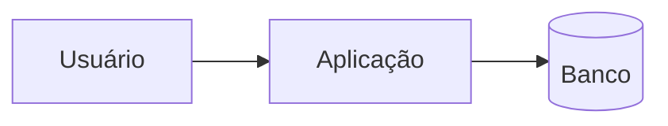

# Arquitetura

> Atualizado na mesma mudança que altera uma convenção ou um componente. Decisões que
> justificam esta arquitetura estão em [`../adr/`](../adr/README.md).

## Visão geral

<Diagrama de contexto e parágrafo curto: o sistema, seus usuários e as dependências externas.>

## Componentes

| Componente | Responsabilidade | Onde vive |
|---|---|---|
| — | — | — |

## Convenções

- Camadas e direção de dependência:
- Tratamento de erro:
- Autorização:
- Logs e auditoria:

## Contrato de API

Registro de endpoints: [`api-contract.md`](api-contract.md).
