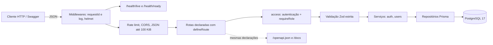

# Arquitetura

> Atualizado na mesma mudança que altera uma convenção ou um componente. Decisões que
> justificam esta arquitetura estão em [`../adr/`](../adr/README.md).

## Visão geral

Uma API REST num único processo Node.js (monólito modular, [ADR-0001](../adr/0001-monolito-modular.md)),
com PostgreSQL como única dependência. Quem a consome são clientes HTTP: USER para a própria conta
e ADMIN para a gestão de usuários.

## Componentes

| Componente | Responsabilidade | Onde vive |
|---|---|---|
| Bootstrap | Env validado, logger, client Prisma, listen e shutdown | `src/server.ts`, `src/config/` |
| App | Monta o Express sem abrir porta, na ordem de middlewares acima | `src/app.ts` |
| Camada HTTP | Erros, logs, validação, rate limit, `defineRoute`, OpenAPI | `src/http/` |
| Auth | Senha, tokens, sessões, login, renovação, troca de senha, autenticação | `src/modules/auth/` |
| Users | Perfil, listagem e gestão pelo admin, guarda do último admin | `src/modules/users/` |
| Health | `live` e `ready` | `src/modules/health/` |
| Composição | Liga serviços às rotas; seed do primeiro admin | `src/api-routes.ts`, `src/admin-seed.ts`, `src/scripts/` |
| Entrega | Imagem multi-stage sem root; Compose com `api`, `db`, `migrate` e `seed-admin`; CI | `Dockerfile`, `compose.yaml`, `.github/workflows/ci.yml` |

### Responsabilidade de cada camada

| Camada | Faz | Não faz |
|---|---|---|
| Middlewares globais | `requestId`, log de acesso, helmet, rate limit, CORS, parse do JSON com limite de 100 KiB | Nada de regra de negócio |
| Rota (`defineRoute`) | Declara método, path, `access`, papel exigido, schemas e respostas, e monta a rota e o OpenAPI a partir disso | Acessar o banco |
| Autenticação e papel | Valida o access token e relê usuário e papel no banco; exige o papel da rota | Confiar no papel do token |
| Validação (Zod estrito) | Normaliza e recusa body, query e params fora do schema, num único `400` | Consultar estado |
| Handler | Traduz a entrada validada numa chamada de serviço e o resultado em resposta HTTP | Decidir regra |
| Serviço | Regras de negócio, transações e locks (último admin, rotação de sessão) | Montar resposta HTTP |
| Repositório | Consultas Prisma, sempre filtrando usuários excluídos | Decidir permissão |

### Execução

- **Local:** `npm run dev` com o banco do Compose.
- **Container:** a imagem roda `node dist/server.js` com o usuário `node`, healthcheck no
  `/health/ready` e encerramento gracioso no SIGTERM, com prazo de 10 s para as requisições em
  andamento. As migrations são um passo explícito (`migrate`), nunca parte do `up`.
- **CI:** um job verifica e testa contra PostgreSQL 17. Outro builda a imagem e faz o smoke test
  do Compose num banco vazio.

## Convenções

- **Camadas e direção de dependência:** rota → validação → handler → serviço → repositório.
  `users` não importa `auth`; o que ele precisa (hash de senha, revogar sessões, autenticar) chega
  por injeção em `src/api-routes.ts`. Toda rota de `/api/v1` é declarada com `defineRoute`, que
  monta a rota e a documenta no OpenAPI ([ADR-0004](../adr/0004-openapi-gerado-dos-schemas.md)).
- **Tratamento de erro:** serviços lançam `AppError` com um código do catálogo; o `errorHandler`
  devolve o envelope `{ error: { code, message, requestId, details? } }`. Qualquer outro erro vira
  500 `INTERNAL` com mensagem genérica e é logado uma única vez.
- **Autorização:** toda rota declara `access` (`'public'` ou o middleware de autenticação) e, se
  for administrativa, `requireRole: 'ADMIN'`. O usuário e o papel são relidos do banco a cada
  requisição, nunca lidos do token. O teste de contrato trava quais rotas são públicas e quais
  aceitam qualquer papel; as demais têm de exigir ADMIN.
- **Logs e auditoria:** uma linha JSON por requisição (allowlist: id, método, path sem query,
  status). Eventos de domínio (`login_failed`, `refresh_reuse_detected`, `role_changed`,
  `user_deleted`…) levam ids, nunca e-mail, senha ou token. As ações de admin registram `actorId`
  e `targetId`.

### Concorrência e ordem de locks

Invariantes que dependem de várias linhas são protegidas por advisory locks de transação
(`pg_advisory_xact_lock`), sempre tomados nesta ordem, nunca na inversa:

1. **Conjunto de admins** (`users:admin-set`): mudança de papel, exclusão e seed do admin. Garante
   que sempre exista um ADMIN ativo.
2. **Sessões do usuário** (`refresh-sessions:<id>`): renovação, login, troca de senha, revogação
   em massa. Garante que nenhuma sessão sobreviva a uma detecção de roubo, a uma troca de senha ou
   a uma exclusão ([ADR-0003](../adr/0003-modelo-de-sessao.md)).
3. **Linhas** de `refresh_sessions` e de `users`, por último.

Uma transação que já alterou a linha do usuário não pode pedir o lock de sessões depois. Por
isso, numa troca de senha ou exclusão, `revokeAllForUser(userId, tx)` vem antes do `UPDATE` em
`users`. Os testes de corrida forçam as intercalações perigosas com `pg_stat_activity`, em vez de
depender do escalonamento.

## Contrato de API

Registro de endpoints: [`api-contract.md`](api-contract.md). Fonte gerada: `GET /openapi.json`.
